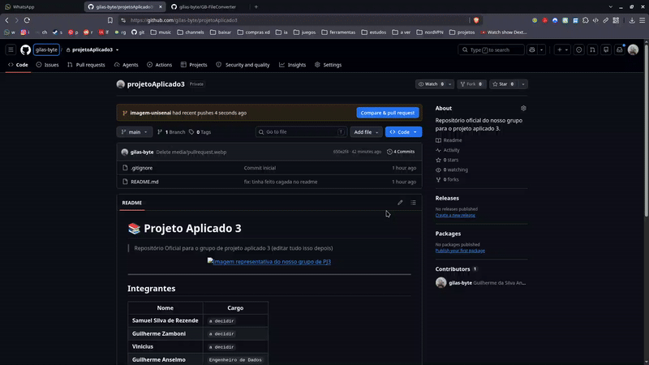

# 📚​ Projeto Aplicado 3

> Repositório Oficial para o grupo de projeto aplicado 3 Unisenai

<p align="center">
    
</p>

---

## 👥​ Integrantes


| Nome | Cargo |
| --- | -- |
|**Samuel Silva de Rezende**|`Líder / Product Owner`|
|**Vinícius Joacir dos Anjos**|`Líder de Desenvolvimento e IA`|
|**Guilherme da Silva Anselmo**|`QA, Validações, Integridade e Segurança · Design e Frontend`|

---

## 🔒 Protecao de dados (LGPD)

Os microdados nunca vao para o repositorio e nenhum grupo com menos de 100
participantes e publicado. Regras completas e checklist de PR em
[`docs/privacidade.md`](docs/privacidade.md). Antes de abrir um PR que
toque dados:

```
./.venv/bin/python scripts/verificar_piso.py
```

---

## ⚙️ Pipeline de dados

Stack decidida por benchmark em [`docs/stack/`](docs/stack/README.md).
Com os zips do INEP extraidos em `data/raw/`:

```
./scripts/verify_raw.sh                        # confere os hashes da fonte
./.venv/bin/python scripts/etl.py              # RAW -> TRUSTED -> ANALYTICS (~1 min)
./.venv/bin/python -m unittest discover tests  # testes com dados sinteticos
./.venv/bin/streamlit run app/app.py            # app (MVP)
```

Saidas locais (fora do git): `data/trusted/enem/ano=<ano>/` com as colunas
do contrato e a flag `elegivel`, o manifesto com hash e funil de cada
edicao, e `data/analytics/dist_notas.parquet` para histogramas (faixas protegidas),
`data/analytics/dist_exata.parquet` para percentis populacionais exatos e
`data/analytics/_manifesto_analytics.json` para verificacao de integridade.

O aplicativo usa **duas estruturas agregadas distintas**: as faixas (histogramas)
e a CDF exata de notas (percentis sem interpolacao). O arquivo exato contem
frequencias que podem ser inferiores a 100 por nota e deve ficar restrito ao
backend, nunca disponibilizado como download, arquivo estatico ou API.
O publico recebe somente percentis arredondados e histogramas com piso de grupo.
Nenhum registro individual ou identificador de inscricao e carregado online.

---

## 📋 Trilha técnica AV3

- [`docs/av3/README.md`](docs/av3/README.md): arquitetura, criterios da AV3,
  limites de testes, plano de verificacao de volumetria e responsabilidades.
- [`docs/av3/DECISAO-001-percentil-exato.md`](docs/av3/DECISAO-001-percentil-exato.md):
  decisao arquitetural sobre percentil exato versus agrupamento para graficos.
- `scripts/estatistica.py`: funcao pura de percentil empirico exato por posto medio.
- `scripts/etl.py`: gera CDF exata, histograma protegido e manifesto de ANALYTICS.
- `tests/test_percentil_exato.py`: exemplos controlados de empate e fronteiras.
- `tests/test_analytics.py`: teste de ponta a ponta (RAW sintetico -> TRUSTED -> ANALYTICS) com calculo independente.
- `.github/workflows/qualidade.yml`: proposta de CI para checagem sintatica,
  testes sinteticos e validacao de piso de divulgacao.

### Verificacao da versao

```sh
python -m compileall -q scripts app tests
python -m unittest discover -s tests -p 'test_percentil_exato.py' -v
python scripts/verificar_piso.py
# Requer duckdb e streamlit instalados (25 testes):
python -m unittest discover -s tests -v
# Requer os CSVs INEP em data/raw/:
python scripts/etl.py
cat data/analytics/_manifesto_analytics.json
```

**Status:** testes sinteticos de ponta a ponta aprovados (25 testes). A execucao
integral do ETL sobre os microdados reais e os numeros finais da camada
ANALYTICS permanecem pendentes (exigem os CSVs do INEP em `data/raw/`). Nao
confundir benchmark com ETL final.

---

## ​🖥️​ Crie branches para seus pull requests

Para cada feature, fix, docs, etc. repita os seguintes passos

```
git checkout -b nome-mudanca
```

Adicione os arquivos nos quais você alterou e de commit.

```
git add .

git commit -m "minha mudança"
```

E de um git push para sua branch.

```
git push origin nome-mudanca
```

E por fim crie o pull request pela web.

<p align="center">
    
    <br><em>Siga os passos no gif e faça seu Pull Request.</em>
</p>

---

**Bora cozinhar ai piazada.**