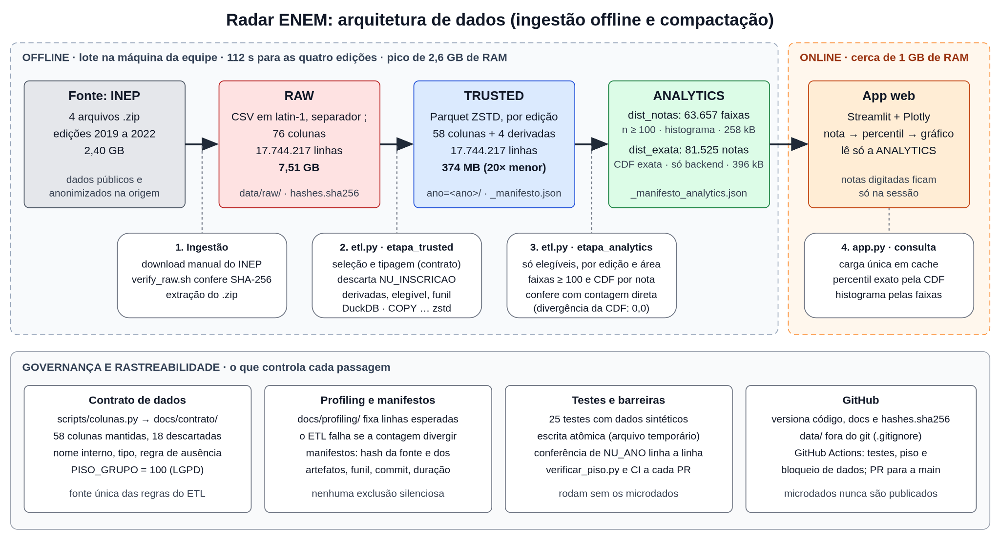

# AV3 — Relatório Técnico de Engenharia de Dados

**Projeto:** Radar ENEM, diagnóstico estatístico comparativo com os Microdados do ENEM 2019–2022
**Equipe A:** Samuel Silva de Rezende (Líder / Product Owner) · Vinícius Joacir dos Anjos (Líder de Desenvolvimento e IA) · Guilherme da Silva Anselmo (QA, Validações, Integridade e Segurança · Design e Frontend)
**Orientador:** Gustavo Stangherlin Cantarelli
**Curso:** Bacharelado em Ciência de Dados e Inteligência Artificial, 4ª fase, Projeto Aplicado III · Centro Universitário SENAI SC, Campus Florianópolis
**Data:** 13/10/2026 (Sprint 4)

**Repositório:** https://github.com/gilas-byte/projetoAplicado3
**Branch de engenharia:** https://github.com/gilas-byte/projetoAplicado3/tree/engineering-av3-melhorias

---

## 1. Introdução e escopo

O Radar ENEM recebe as notas de um participante e mostra a posição delas na distribuição de uma edição do exame. A fonte são os Microdados do ENEM publicados pelo INEP, edições de 2019 a 2022: quatro arquivos CSV que somam 7,51 GB e 17,7 milhões de linhas.

O obstáculo é de arquitetura. Ler um CSV desse tamanho leva dezenas de segundos e alguns gigabytes de memória, enquanto a aplicação web precisa responder em até 3 s (RNF02) em hospedagem gratuita com cerca de 1 GB de RAM. A solução adotada separa o processamento em lote do atendimento a consultas (Kleppmann, 2017): o trabalho pesado roda uma vez, offline, e produz artefatos compactados; a aplicação só consulta esses artefatos.

Este relatório documenta o pipeline de ETL que faz essa transformação: a arquitetura de dados, o código, os requisitos, a volumetria e a governança. Todos os números de volumetria, tempo e memória da seção 5 foram medidos em 13/10/2026, em uma execução completa do pipeline sobre os microdados reais das quatro edições, no commit `9a56663` da `main`, na máquina descrita na seção 5.1. Os números de comparação entre ferramentas vêm do benchmark de 25/09/2026 (`docs/stack/`).

Unidades: GB e MB são decimais (10⁹ e 10⁶ bytes), calculados a partir dos tamanhos em bytes gravados no manifesto do pipeline. Onde uma tabela reproduz o benchmark, que foi gerado em unidades binárias, isso está indicado.

## 2. Arquitetura e modelagem de dados

### 2.1 Diagrama



*Figura 1. Fluxo de dados da fonte até a aplicação, com os controles de governança de cada passagem. Arquivo-fonte: `docs/relatorio/arquitetura.svg`.*

### 2.2 Camadas

| Camada | Conteúdo | Formato e local | Tamanho | Quem lê |
| --- | --- | --- | --- | --- |
| RAW | Arquivo oficial do INEP, sem alteração | `.zip` e CSV em latin-1, `data/raw/` | 2,40 GB (zip), 7,51 GB (CSV) | Só o ETL |
| TRUSTED | Um registro por inscrito, com as colunas do contrato, tipadas, e a marca de elegibilidade | Parquet ZSTD, `data/trusted/enem/ano=<ano>/data_0.parquet` | 374 MB | ETL e análises da equipe |
| ANALYTICS | Distribuição das notas dos elegíveis, em duas formas: faixas de pelo menos 100 participantes e distribuição acumulada exata | Parquet ZSTD, `data/analytics/dist_notas.parquet` e `dist_exata.parquet` | 654 kB | A aplicação web |

Nenhuma das três camadas é versionada no Git. O repositório guarda o código, a documentação e o arquivo `data/raw/hashes.sha256`, que identifica a fonte.

### 2.3 Ingestão offline

A ingestão é manual e acontece uma vez por edição. Um integrante baixa o `.zip` do portal de dados abertos do INEP para `data/raw/` e roda `scripts/verify_raw.sh`, que compara o SHA-256 do arquivo com o registrado no repositório. Só depois o `.zip` é extraído. Assim, toda máquina da equipe processa exatamente os mesmos bytes, e o manifesto de cada execução registra de qual arquivo o resultado saiu.

A ingestão não foi automatizada porque a fonte é estática (quatro arquivos que o INEP não republica com frequência) e o download automático não traria ganho que justificasse o código a manter.

### 2.4 Modelo de dados

**TRUSTED.** Uma tabela por edição, com o mesmo esquema nas quatro. O grão é o inscrito.

| Grupo | Colunas | Tipo | Origem |
| --- | --- | --- | --- |
| Partição | `ano` | BIGINT | `NU_ANO`, gravado no nome da pasta (partição Hive) |
| Presença e elegibilidade | `presenca_cn`, `presenca_ch`, `presenca_lc`, `presenca_mt`, `treineiro` | BIGINT | `TP_PRESENCA_*`, `IN_TREINEIRO` |
| Notas | `nota_cn`, `nota_ch`, `nota_lc`, `nota_mt` | DOUBLE | `NU_NOTA_*` |
| Redação | `nota_redacao`, `nota_redacao_comp1` a `comp5`, `status_redacao` | BIGINT | `NU_NOTA_REDACAO`, `NU_NOTA_COMP*`, `TP_STATUS_REDACAO` |
| Perfil | `faixa_etaria`, `sexo`, `estado_civil`, `cor_raca`, `nacionalidade`, `lingua_estrangeira` | BIGINT, VARCHAR | `TP_*` |
| Trajetória escolar | `situacao_conclusao`, `anos_desde_conclusao`, `tipo_escola`, `tipo_ensino`, `dependencia_adm_escola`, `localizacao_escola`, `uf_escola` | BIGINT, VARCHAR | `TP_*`, `SG_UF_ESC` |
| Local de prova | `uf_prova`, `cod_municipio_prova`, `municipio_prova` | VARCHAR, BIGINT | `SG_UF_PROVA`, `CO_/NO_MUNICIPIO_PROVA` |
| Questionário | `escolaridade_pai` … `acesso_internet` (25 colunas) | VARCHAR, BIGINT | `Q001` a `Q025` |
| Derivadas | `ano_conclusao`, `conclusao_antes_2007`, `renda_sm`, `elegivel` | BIGINT, BOOLEAN, DOUBLE, BOOLEAN | Calculadas no ETL (seção 3.3) |

São 58 colunas mantidas do INEP mais 4 derivadas, 62 no total. O dicionário completo, com regra de ausência e transformação de cada campo, está em `docs/contrato/README.md`.

**ANALYTICS.** Duas tabelas, ambas com o grão de uma edição e uma área, sem identificador nem atributo de pessoa.

`dist_notas`, 63.657 linhas, alimenta o histograma:

| Coluna | Tipo | Significado |
| --- | --- | --- |
| `ano` | BIGINT | Edição |
| `area` | VARCHAR | `cn`, `ch`, `lc`, `mt` ou `redacao` |
| `nota_min`, `nota_max` | DOUBLE | Limites da faixa de nota |
| `n` | BIGINT | Participantes elegíveis na faixa, sempre 100 ou mais |

`dist_exata`, 81.525 linhas, responde ao percentil:

| Coluna | Tipo | Significado |
| --- | --- | --- |
| `ano`, `area` | BIGINT, VARCHAR | Edição e área |
| `nota` | DOUBLE | Nota observada (uma linha por nota distinta) |
| `n` | BIGINT | Elegíveis com exatamente essa nota |
| `abaixo` | BIGINT | Elegíveis com nota estritamente menor |
| `total` | BIGINT | Elegíveis com nota na edição e área |

A primeira pode acompanhar a aplicação sem restrição. A segunda guarda frequências por nota que podem ser menores que 100 e fica restrita ao backend (seção 6.4).

### 2.5 Decisões de modelagem

| Decisão | Motivo |
| --- | --- |
| Uma partição por edição (`ano=<ano>/`) | As edições não são populações equivalentes e o produto nunca compara notas entre elas. Uma consulta sobre 2022 lê só o arquivo de 2022, e reprocessar uma edição não toca as outras. |
| `elegivel` é uma coluna, não um filtro | A TRUSTED mantém todos os inscritos. Quem faltou, foi eliminado ou era treineiro continua no arquivo, marcado, e entra na contagem do funil. O plano de trabalho veda exclusão silenciosa. |
| Códigos do INEP preservados | Os rótulos de três variáveis mudam entre edições; os códigos, não. Traduzir para texto na TRUSTED fixaria o rótulo de um ano como se valesse para os outros. |
| `NU_INSCRICAO` descartado na passagem RAW → TRUSTED | O produto só publica agregados. O identificador não tem uso analítico e carrega risco de reidentificação (LGPD). |
| ANALYTICS pré-agregada, em dois artefatos | Resolve a latência e a memória do runtime. As faixas de 100 ou mais atendem ao piso de tamanho de grupo no que é exibido; a distribuição acumulada dá o percentil exato e fica restrita ao backend (ADR-001). |

## 3. Pipeline de ETL e código-fonte

O pipeline inteiro está em `scripts/etl.py` (402 linhas) e roda com um comando: `./.venv/bin/python scripts/etl.py`. Ele depende de três módulos: `scripts/colunas.py` (o contrato de dados), `scripts/estatistica.py` (as faixas e a distribuição acumulada) e o DuckDB 1.5.5 como motor de execução.

### 3.1 Contrato de dados como fonte única

`scripts/colunas.py` define, para cada uma das 76 colunas do INEP, o destino (mantida ou descartada), o nome interno, o tipo e a regra de ausência. O ETL não tem lista própria de colunas: ele pergunta ao contrato.

```python
def mantidas() -> list[str]: ...   # as 58 colunas que seguem para a TRUSTED
def tipo(coluna: str) -> str: ...  # "texto", "real" ou "inteiro"
PISO_GRUPO = 100                   # piso de tamanho de grupo (LGPD)
```

O mesmo módulo gera `docs/contrato/contrato.json` e a versão legível em `docs/contrato/README.md`. Mudar uma regra é mudar um arquivo, e a documentação é regerada a partir dele.

### 3.2 Leitura tipada do CSV

```python
def ler_csv(csv: Path) -> str:
    tipos = ", ".join(f"'{c}': '{TIPOS_SQL[tipo(c)]}'" for c in mantidas())
    return (
        f"read_csv('{csv}', delim=';', header=true, encoding='latin-1', "
        f"types={{{tipos}}})"
    )
```

A função monta a chamada `read_csv` do DuckDB com o separador e a codificação do INEP e com o tipo de cada coluna fixado pelo contrato. Fixar os tipos impede que o motor os deduza por amostragem, o que poderia ler uma coluna como inteiro em uma edição e como texto em outra. O DuckDB lê latin-1 diretamente, sem a etapa de conversão para UTF-8 que o Polars exigiria.

### 3.3 Seleção, renomeação e colunas derivadas

`selecao_trusted(ano)` monta o `SELECT` da passagem RAW → TRUSTED. Cada coluna mantida é renomeada para o nome interno, e quatro colunas são derivadas:

```python
f"CASE WHEN TP_ANO_CONCLUIU BETWEEN 1 AND {antes_2007 - 1} "
f"THEN {ano} - TP_ANO_CONCLUIU END AS ano_conclusao",
f"TP_ANO_CONCLUIU = {antes_2007} AS conclusao_antes_2007",
f"CAST(CASE Q006 {renda} END AS DOUBLE) AS renda_sm",
f"({presentes} AND IN_TREINEIRO = 0) AS elegivel",
```

- `ano_conclusao`: o código de `TP_ANO_CONCLUIU` é um deslocamento em relação ao ano da prova, não um ano. A coluna converte para o ano absoluto. O código 0 (não informado) e o maior código da edição (que rotula "antes de 2007") ficam nulos.
- `conclusao_antes_2007`: marca própria para esse último caso, para que ele não se confunda com "não informado".
- `renda_sm`: piso da faixa de renda de `Q006` em múltiplos do salário mínimo da edição. É a unidade em que as 17 faixas são comparáveis entre 2019 e 2022.
- `elegivel`: verdadeiro para quem esteve presente nas quatro áreas e não é treineiro. É a população de comparação do produto.

### 3.4 Gravação compactada e atômica

```python
temporario = final / ".data_0.parquet.tmp"
con.execute(f"""
    COPY (
        SELECT * EXCLUDE (ano)
        FROM (SELECT {selecao_trusted(ano)} FROM {ler_csv(csv)})
        WHERE CASE WHEN ano IS DISTINCT FROM {ano}
                   THEN error('NU_ANO diferente de {ano} em {csv.name}')
                   ELSE true END
    ) TO '{temporario}' (FORMAT parquet, COMPRESSION zstd)
""")
temporario.replace(final / "data_0.parquet")
```

Este é o trecho que faz a compactação. Três cuidados estão nele:

1. **Leitura e escrita em fluxo.** O `COPY` lê o CSV e grava o Parquet em uma única consulta, sem materializar a edição inteira na memória do Python.
2. **Escrita atômica.** O arquivo é gravado com nome temporário e só substitui a partição no fim. Se a execução for interrompida, a TRUSTED não fica com uma edição pela metade; em caso de erro, o temporário é apagado.
3. **Conferência do ano linha a linha.** A coluna `ano` sai do arquivo porque passa a vir do nome da pasta. Antes disso, o `WHERE` aborta a carga se algum registro do CSV tiver `NU_ANO` diferente da edição esperada, o que pegaria um arquivo colocado na pasta errada.

O particionamento é feito à mão, uma consulta por edição, em vez do `PARTITION_BY` do DuckDB. A medição mostrou que o `PARTITION_BY` dobrava o pico de memória (5,1 GB contra 2,4 GB na edição de 2022).

### 3.5 Funil de elegibilidade

```python
SELECT count(*),
       count(*) FILTER (treineiro = 1),
       count(*) FILTER (treineiro = 0 AND ({algum(2)})),
       count(*) FILTER (treineiro = 0 AND NOT ({algum(2)}) AND ({algum(0)})),
       count(*) FILTER (elegivel)
FROM read_parquet('{particao}/*.parquet')
```

Depois de gravar cada edição, `funil()` relê a partição e conta os inscritos por destino: treineiros, eliminados em alguma área, faltosos em alguma área e elegíveis. As categorias são mutuamente exclusivas e somam o total de inscritos. O resultado é o relatório de qualidade da carga:

| Edição | Inscritos | Treineiros | Eliminados | Faltaram em alguma área | Elegíveis | % elegível |
| --- | --- | --- | --- | --- | --- | --- |
| 2019 | 5.095.171 | 616.667 | 5.272 | 1.299.020 | 3.174.212 | 62,3% |
| 2020 | 5.783.109 | 557.425 | 5.077 | 2.978.438 | 2.242.169 | 38,8% |
| 2021 | 3.389.832 | 437.190 | 4.691 | 1.077.217 | 1.870.734 | 55,2% |
| 2022 | 3.476.105 | 512.732 | 5.243 | 1.030.377 | 1.927.753 | 55,5% |
| **Total** | **17.744.217** | **2.124.014** | **20.283** | **6.385.052** | **9.214.868** | **51,9%** |

Em cada linha, as quatro categorias somam o número de inscritos: nenhum registro se perde entre o CSV e a TRUSTED.

### 3.6 Validação contra o profiling e manifesto

```python
if f["inscritos"] != esperado:
    raise ValueError(f"{ano}: {f['inscritos']} linhas, profiling diz {esperado}")

manifesto[str(ano)] = {
    "fonte": f"microdados_enem_{ano}.zip",
    "sha256": hash_zip(ano),
    "csv_bytes": csv.stat().st_size,
    "parquet_bytes": sum(p.stat().st_size for p in particao.glob("*.parquet")),
    "funil": f,
    "gerado_em": time.strftime("%Y-%m-%dT%H:%M:%S"),
    "duckdb": duckdb.__version__,
}
```

O número de linhas gravadas é comparado com o que o profiling da Sprint 1 registrou para a edição (`docs/profiling/profiling_<ano>.json`). Se divergir, a execução falha. Passando, o ETL grava em `data/trusted/enem/_manifesto.json` a linhagem daquela edição: de qual arquivo saiu, com qual hash, quantos bytes entraram e saíram, o funil, quando e com qual versão do motor.

### 3.7 Agregação da camada ANALYTICS

`etapa_analytics()` consulta a TRUSTED das quatro edições como uma tabela só e, para cada edição e área, conta quantos elegíveis tiraram cada nota. Dessa lista de contagens saem dois artefatos, com finalidades diferentes.

**Faixas protegidas, para o histograma.** A função `faixas()`, em `scripts/estatistica.py`, percorre as notas em ordem crescente e junta notas vizinhas até acumular pelo menos 100 participantes:

```python
for nota, n in contagens:
    if inicio is None:
        inicio = nota
    acumulado += n
    if acumulado >= piso:
        saida.append((inicio, nota, acumulado))
        inicio, acumulado = None, 0
```

A sobra final, se ficar abaixo do piso, entra na última faixa; se o total da área não chegar a 100, nada é publicado. O resultado é `dist_notas.parquet`, que alimenta o gráfico sem nunca expor um grupo pequeno.

**Distribuição acumulada exata, para o percentil.** A função `construir_acumulada()` transforma as mesmas contagens em uma tabela com uma linha por nota distinta: a nota, quantos a tiraram e quantos ficaram abaixo dela.

```python
for nota, n in contagens:
    if not isfinite(nota) or nota <= anterior or not isinstance(n, int) or n <= 0:
        raise ValueError('frequencias precisam ter notas finitas crescentes e n positivo')
    resultado.append((float(nota), n, abaixo))
    abaixo += n
    anterior = nota
```

O resultado é `dist_exata.parquet`. Com ele, o percentil de qualquer nota sai por busca binária, sem interpolação, pela regra do posto médio: `(abaixo + iguais / 2) / total × 100`. A função rejeita notas repetidas, fora de ordem ou com frequência não positiva, para que um erro na consulta não vire um percentil errado.

A decisão de manter os dois artefatos está registrada em `docs/av3/DECISAO-001-percentil-exato.md`. As faixas respondiam ao percentil por interpolação, com erro de até 0,0047 ponto percentual (medido em 13/10/2026 na versão anterior do pipeline). A CDF elimina essa aproximação, ao custo de guardar frequências por nota que podem ser menores que 100; por isso o arquivo é de uso exclusivo do backend (seção 6.4).

### 3.8 Validação antes de publicar

Os dois artefatos são gravados com nome temporário e só substituem os anteriores depois de quatro conferências. Se qualquer uma falhar, a execução aborta e os arquivos em uso ficam intactos.

```python
if sum(n for *_, n in f) != total:
    raise AssertionError(f'{ano}/{area}: histograma nao conserva contagens')
if acumulada[-1][2] + acumulada[-1][1] != total:
    raise AssertionError(f'{ano}/{area}: CDF nao conserva contagens')
...
for nota in sorted(amostra):
    esperado = percentil_exato(con, fonte, ano, area, nota)
    obtido = percentil_exato_acumulado(cdf, nota)
    if abs(obtido - esperado) > 1e-9:
        raise AssertionError(...)
```

1. **Conservação de contagens.** As faixas e a CDF de cada edição e área têm de somar o total de elegíveis com nota.
2. **Integridade do arquivo.** O Parquet temporário é relido e o número de linhas comparado com o que foi gerado.
3. **Erro das faixas.** Para sete notas de cada edição e área, o percentil pelas faixas é comparado com o exato; o erro não pode passar do peso da maior faixa.
4. **Exatidão da CDF.** Para até onze notas de cada edição e área (a menor, a maior, a mediana das observadas, valores fora do intervalo, uma nota não observada e cinco valores fixos), o percentil pela CDF é comparado com a contagem direta sobre o dado individual da TRUSTED. A tolerância é 10⁻⁹.

Na execução de 13/10/2026 sobre os microdados reais, a maior divergência entre a CDF e a contagem direta foi **0,0**.

Depois de publicar, o ETL grava `data/analytics/_manifesto_analytics.json` com o commit do código, a duração, o resultado da conferência, os totais por edição e área e o tamanho, o número de linhas e o SHA-256 de cada artefato (seção 6.3).

### 3.9 Testes

Os 25 testes automatizados (`tests/`) rodam sem os microdados, com dados sintéticos de resultado conhecido, em cerca de 25 s. Na parte de engenharia, cobrem:

| Arquivo | Testes | O que garantem |
| --- | --- | --- |
| `test_etl.py` (TRUSTED) | 4 | `NU_INSCRICAO` não chega à TRUSTED; regras de elegibilidade e colunas derivadas para seis casos; o funil soma o total; CSV de outra edição aborta sem deixar arquivo parcial |
| `test_etl.py` (faixas) | 5 | Toda faixa tem 100 ou mais; as faixas somam o total e não se sobrepõem; grupo abaixo do piso não gera artefato; erro do percentil por faixas limitado |
| `test_percentil_exato.py` | 4 | Empates, nota não observada, limites e frequências inválidas na CDF, em Python puro |
| `test_analytics.py` | 8 | Ponta a ponta: RAW sintético → TRUSTED → ANALYTICS com as funções reais do ETL, comparando a CDF publicada com um cálculo independente |
| `test_app.py` | 4 | Percentil exibido, grupo insuficiente, nenhuma nota informada e notas fora da URL |

## 4. Requisitos funcionais e não funcionais

Os requisitos são os do Plano de Trabalho (item 7). A tabela mostra o que a camada de dados já sustenta e o que depende das próximas sprints.

### 4.1 Requisitos funcionais

| ID | Requisito | Situação | Evidência ou pendência |
| --- | --- | --- | --- |
| RF01 | Usuário informa notas e os atributos do módulo | Parcial | O app recebe as cinco notas e a edição. Os atributos de módulo (renda, UF, escolaridade dos pais, rede) já estão na TRUSTED; a entrada na interface vem com os módulos, na Sprint 5. |
| RF02 | Estatísticas do grupo de referência: n, tendência, dispersão, percentil, Z-Score | Parcial | Percentil empírico exato (posto médio) e n entregues. Média, desvio-padrão e Z-Score na Sprint 5. |
| RF03 | Quatro módulos comparativos autorais | Pendente | Sprint 5. O contrato já mantém os campos que cada módulo consome. |
| RF04 | Visualizações e explicações metodológicas, com limitações | Parcial | Histograma com a nota marcada e bloco "Como a posição é calculada". |
| RF05 | Tratar entradas inválidas e grupos insuficientes sem falhar | Parcial | Tratados e testados: nenhuma nota informada, área sem dados, artefatos ausentes. Categorias de módulo na Sprint 5. |
| RF06 | Aplicação web pública e gratuita | Pendente | A aplicação roda localmente. O método de hospedagem ainda não foi definido; há um planejamento prévio em `docs/av3/EVOLUCAO-FUTURA-NUVEM.md`. |

### 4.2 Requisitos não funcionais

| ID | Requisito | Situação | Evidência ou pendência |
| --- | --- | --- | --- |
| RNF01 | Não carregar o CSV bruto no runtime | Atendido | O app lê só os dois artefatos da ANALYTICS (654 kB no total), uma vez, com cache compartilhado entre sessões. |
| RNF02 | Consultas representativas em até 3 s no ambiente-alvo | Parcial | Medido localmente: carga dos dois artefatos em 0,19 s, uma vez; percentil pela CDF em 0,11 ms. Falta medir no ambiente de hospedagem. |
| RNF03 | Pipeline reprodutível, versionado, testado e rastreável | Parcial | Um comando reproduz as três camadas; hash da fonte, manifestos, 25 testes, integração contínua e Pull Requests. Faltam tags de release e revisão formal (seção 6.5). |
| RNF04 | Não persistir os dados informados pelo usuário | Atendido | Notas só no estado da sessão; sem gravação, log ou URL. Teste `test_notas_nao_vao_para_a_url` e `.streamlit/config.toml`. |
| RNF05 | Segurança, acessibilidade, clareza, responsividade e monitoramento | Parcial | Telemetria de terceiros desligada e erros sem valores digitados. Acessibilidade e monitoramento na Sprint 6. |

### 4.3 Requisitos do pipeline (Plano de Trabalho, item 5)

| Requisito | Situação | Onde |
| --- | --- | --- |
| Fonte oficial preservada e identificada por SHA-256 | Atendido | `data/raw/hashes.sha256`, `scripts/verify_raw.sh` |
| Profiling de volume, tipos, cardinalidades e ausências | Atendido | `scripts/profiling.py`, `docs/profiling/` |
| Contrato de dados por campo | Atendido | `scripts/colunas.py`, `docs/contrato/` |
| Funil de qualidade, sem perda silenciosa | Atendido | `funil()` em `scripts/etl.py`; seção 3.5 |
| Ausência, prova não feita e zero como estados distintos | Atendido | Notas ausentes ficam nulas, nunca zero; regras no contrato |
| Manifesto de execução | Parcial | O da ANALYTICS registra commit, data, duração, totais e hash dos artefatos. O da TRUSTED registra fonte, hash, bytes, funil, data e versão do DuckDB, sem commit nem duração. Nenhum dos dois tem identificador de execução. |
| Reprodutibilidade com fixtures sintéticas | Atendido | Os testes geram os dados sintéticos em tempo de execução; nenhum microdado é versionado |
| Piso de tamanho de grupo (LGPD) | Atendido no que é exibido | `PISO_GRUPO`, `faixas()`, `scripts/verificar_piso.py`. A CDF interna guarda frequências menores que 100 e não pode ser exposta (seção 6.4). |

## 5. Volumetria e otimização

### 5.1 Ambiente da medição

Notebook com Intel Core i5-9300H (8 threads), 15,4 GB de RAM, Linux, Python 3.12.3 e DuckDB 1.5.5. Execução completa de `scripts/etl.py` em 13/10/2026, no commit `9a56663` da `main`, medida com `/usr/bin/time -v`.

### 5.2 Volumetria final

| Edição | ZIP do INEP | CSV (RAW) | Parquet (TRUSTED) | Razão CSV / Parquet | Linhas | Grupos de linhas |
| --- | --- | --- | --- | --- | --- | --- |
| 2019 | 660 MB | 2,41 GB | 111,4 MB | 21,6× | 5.095.171 | 42 |
| 2020 | 621 MB | 2,02 GB | 114,0 MB | 17,8× | 5.783.109 | 47 |
| 2021 | 498 MB | 1,51 GB | 73,1 MB | 20,6× | 3.389.832 | 28 |
| 2022 | 621 MB | 1,57 GB | 75,8 MB | 20,7× | 3.476.105 | 29 |
| **Total** | **2,40 GB** | **7,51 GB** | **374,3 MB** | **20,1×** | **17.744.217** | **146** |

A camada TRUSTED ocupa **374,3 MB, 95,0% a menos que o CSV** e 6,4 vezes menos que os próprios arquivos `.zip` do INEP, com todas as linhas preservadas.

Os arquivos que a aplicação efetivamente carrega são os da camada ANALYTICS:

| Artefato | Tamanho | Linhas | Conteúdo | Uso |
| --- | --- | --- | --- | --- |
| `dist_notas.parquet` | 258.357 bytes | 63.657 | Faixas de nota com 100 ou mais participantes | Histograma |
| `dist_exata.parquet` | 395.658 bytes | 81.525 | Uma linha por nota distinta, com frequência e acumulado | Percentil exato, só no backend |
| **Total** | **654 kB** | | 4 edições × 5 áreas, 9.214.868 elegíveis no total das edições | |

São cerca de 11 mil vezes menos bytes que o CSV de origem. As quatro áreas objetivas têm de 4.100 a 6.400 notas distintas por edição, agrupadas em 3.300 a 4.900 faixas; a redação, que só admite múltiplos de 20, tem 50 notas distintas e de 45 a 47 faixas.

### 5.3 Tempo e memória do pipeline

| Etapa | Tempo |
| --- | --- |
| TRUSTED 2019 | 9,3 s |
| TRUSTED 2020 | 9,4 s |
| TRUSTED 2021 | 6,6 s |
| TRUSTED 2022 | 6,6 s |
| ANALYTICS, com as conferências | 80,1 s |
| **Total** | **112,3 s** |

Pico de memória residente do processo: **2,65 GB**. O pipeline cabe em um notebook de 8 GB, que é o equipamento previsto no plano.

A geração dos dois artefatos é rápida; quase todo o tempo da etapa ANALYTICS está nas conferências da seção 3.8, que fazem cerca de 360 contagens sobre o dado individual. Antes de a conferência da CDF exata entrar no pipeline, a mesma máquina completava a execução em 65 s. É um custo de validação, pago offline, que troca 47 s de lote pela garantia de que o percentil publicado coincide com a contagem direta.

### 5.4 De onde vem a redução

| Passo | Volume aproximado | Estratégia |
| --- | --- | --- |
| CSV completo, 76 colunas | 7,51 GB | Ponto de partida |
| Só as 58 colunas do contrato, ainda em texto | 1,56 GB | Seleção de colunas |
| Mesmas colunas tipadas e codificadas em Parquet, sem compressão | 521 MB | Formato colunar e tipagem |
| Parquet com ZSTD | 367 MB de dados, 374 MB com metadados | Compressão por coluna |
| Distribuições agregadas (faixas e CDF) | 0,65 MB | Pré-agregação |

1. **Seleção de colunas.** É o maior ganho isolado: 74,7% do volume do CSV está em 18 colunas que o produto não usa. Oito delas (`TX_RESPOSTAS_*` e `TX_GABARITO_*`) guardam a resposta e o gabarito item a item e respondem sozinhas por mais da metade do arquivo. O peso de cada coluna foi medido no profiling, não estimado.
2. **Tipagem e formato colunar.** Um código de categoria que ocupa um ou dois caracteres mais o separador no CSV vira um inteiro codificado por dicionário no Parquet. Valores ausentes, que chegam a 84% em colunas de escola, quase não ocupam espaço.
3. **Compressão ZSTD.** Reduz em mais 30% o Parquet já codificado.
4. **Particionamento por edição.** Não reduz bytes, reduz leitura: uma consulta sobre uma edição abre um arquivo de 73 a 114 MB em vez de 374 MB.
5. **Pré-agregação.** A pergunta central do produto (o percentil de uma nota) é respondida por dois arquivos que somam 654 kB.

Na TRUSTED final, seis colunas concentram 37% do espaço: município de prova (nome e código, 49,6 MB) e as quatro notas objetivas (86,5 MB). São as de maior cardinalidade. Se for preciso reduzir mais, o nome do município pode sair para uma tabela de dimensão com 1,7 mil linhas, mantendo só o código IBGE.

### 5.5 Escolha do codec e do motor

As duas tabelas reproduzem o benchmark de 25/09/2026 (`docs/stack/benchmark.md`), feito sobre os mesmos dados. Os tamanhos estão em unidades binárias, como no arquivo de origem.

Compressão do Parquet, edição de 2019, 58 colunas:

| Codec | Tamanho | Razão sobre o CSV | Escrita | Leitura de uma agregação |
| --- | --- | --- | --- | --- |
| Sem compressão | 142,0 MiB | 16,2× | 2,3 s | 23 ms |
| snappy | 125,1 MiB | 18,4× | 2,2 s | 25 ms |
| gzip | 102,4 MiB | 22,4× | 4,3 s | 32 ms |
| **zstd** | **101,4 MiB** | **22,6×** | **2,4 s** | **36 ms** |

O ZSTD chega ao tamanho do gzip com a velocidade de escrita do snappy. Custa 11 ms a mais por leitura que o snappy, irrelevante diante da meta de 3 s.

Motor do ETL, por edição:

| Motor | Tempo | Pico de memória |
| --- | --- | --- |
| pandas (parser C) | 45 a 76 s | 2,9 a 4,9 GiB |
| pandas (parser pyarrow) | 9 a 17 s | 4,8 a 7,0 GiB |
| Polars, com conversão de latin-1 | 8 a 15 s | 1,9 a 2,7 GiB |
| **DuckDB** | **6 a 9 s** | **2,2 a 2,4 GiB** |
| Spark local | 29 a 40 s | 1,6 GiB |

O Plano de Trabalho previa Polars na transformação. O benchmark mudou a decisão: o DuckDB foi o mais rápido nas quatro edições, lê o latin-1 do INEP sem conversão e gera um Parquet cerca de 20% menor. O Spark foi medido e não adotado, por levar de 4 a 5 vezes o tempo do DuckDB em dados que cabem em uma máquina. A análise completa está em `docs/stack/README.md`.

O benchmark e o ETL final não medem o mesmo arquivo. O benchmark gravou só as 58 colunas do contrato e somou 340,1 MiB (356,6 MB) nas quatro edições; a TRUSTED final tem também as quatro colunas derivadas e soma 374,3 MB. O número de volumetria deste relatório é o do ETL.

### 5.6 Efeito no runtime

Medido em 13/10/2026 sobre os artefatos reais, em um processo Python isolado:

| Operação | Tempo | Frequência |
| --- | --- | --- |
| Carga de `dist_exata.parquet` | 0,12 s | Uma vez, em cache entre sessões |
| Carga de `dist_notas.parquet` | 0,07 s | Uma vez, em cache entre sessões |
| Percentil de uma nota pela CDF exata | 0,11 ms | A cada consulta |

O processo que carrega os dois artefatos ocupa cerca de 110 MB, sem contar o servidor Streamlit. Como exemplo do resultado, a nota 620,0 em Matemática fica acima de 74,5% dos elegíveis de 2022 e de 79,3% dos de 2020.

Para comparação, o benchmark de 25/09/2026 mediu as alternativas que a pré-agregação evita, com o processo preso a 2 núcleos: o mesmo percentil calculado sobre a TRUSTED de 2022 leva 71 ms, e a consulta mais pesada prevista (renda × dependência da escola nas quatro edições, com quartis) leva 1,04 s e 497 MiB em DuckDB, enquanto pandas e Polars passam de 2 GiB e não caberiam no ambiente-alvo.

## 6. Rastreabilidade, governança e versionamento

### 6.1 Repositório e branches

- Repositório: https://github.com/gilas-byte/projetoAplicado3
- Branch de engenharia: https://github.com/gilas-byte/projetoAplicado3/tree/engineering-av3-melhorias
- Branch estável: https://github.com/gilas-byte/projetoAplicado3/tree/main

A engenharia de dados foi desenvolvida em três branches, integradas à `main` por Pull Request:

| Branch | Conteúdo | Pull Request |
| --- | --- | --- |
| `fundacao-dados-raw` | Hash da fonte, profiling, dicionário, contrato de dados e política de LGPD | [#3](https://github.com/gilas-byte/projetoAplicado3/pull/3), integrado em 25/09/2026 |
| `stack-etl-mvp` | Benchmark e decisão da stack, pipeline RAW → TRUSTED → ANALYTICS, app e testes | [#4](https://github.com/gilas-byte/projetoAplicado3/pull/4) e [#5](https://github.com/gilas-byte/projetoAplicado3/pull/5), integrados em 25 e 28/09/2026 |
| `engineering-av3-melhorias` | Percentil exato, validação do ETL, manifesto da ANALYTICS, testes de ponta a ponta, integração contínua e ADR-001 | [#7](https://github.com/gilas-byte/projetoAplicado3/pull/7), integrado em 13/10/2026 |
| `docs-av3-relatorio-engenharia` | Este relatório e o diagrama | A abrir |

O plano previa uma branch única chamada `engineering`. A equipe usou uma branch por entrega, com nome descritivo. As duas primeiras foram apagadas do GitHub depois de integradas, e seu conteúdo permanece consultável pelos Pull Requests. A `engineering-av3-melhorias` parte da `main` que já continha as duas e é a branch de engenharia vigente.

### 6.2 Histórico de commits da engenharia

| Commit | Data | Autor | Entrega |
| --- | --- | --- | --- |
| `721a506` | 18/09 | Vinícius | `feat(dados)`: rastreabilidade da camada RAW e política de versionamento |
| `5ef0066` | 18/09 | Vinícius | `feat(profiling)`: caracterização das quatro edições |
| `7c26624` | 18/09 | Vinícius | `feat(dicionario)`: domínios do INEP e lista de harmonização |
| `ca12644` | 18/09 | Vinícius | `feat(contrato)`: contrato de dados e profiling do questionário |
| `3acd712` | 22/09 | Vinícius | `feat(lgpd)`: piso de tamanho de grupo e política de proteção de dados |
| `57c250a` | 25/09 | Vinícius | `feat(stack)`: benchmark das alternativas e decisão da stack |
| `2aa102e` | 25/09 | Vinícius | `feat(etl)`: pipeline RAW → TRUSTED → ANALYTICS em DuckDB |
| `e5cc13b` | 25/09 | Vinícius | `feat(app)`: MVP nota → percentil → visualização |
| `4713f87` | 13/10 | Samuel | `feat(estatistica)`: percentil empírico exato por posto médio |
| `30c63e1` | 13/10 | Samuel | `feat(etl)`: ANALYTICS gera `dist_exata.parquet` e manifesto com hashes |
| `06ae2e9` | 13/10 | Samuel | `feat(app)`: percentil exibido vem da CDF exata |
| `f43b8ba` | 13/10 | Samuel | `ci`: workflow de qualidade |
| `aba1002` | 13/10 | Samuel | `fix(etl)`: validar a CDF exata contra contagem direta |
| `cd246a4` | 13/10 | Samuel | `test(analytics)`: teste de ponta a ponta com microdados sintéticos |

As mensagens seguem o padrão `tipo(escopo): descrição`, e cada commit corresponde a uma entrega. Os Pull Requests #3, #4 e #5 foram integrados por Guilherme da Silva Anselmo, e o #7 por Vinícius Joacir dos Anjos: em todos, quem integrou não é o autor dos commits.

### 6.3 Rastreabilidade do dado

A cadeia do dado publicado até a fonte pode ser percorrida em cinco passos:

1. `data/raw/hashes.sha256`, versionado, registra o SHA-256 dos quatro arquivos do INEP.
2. `scripts/verify_raw.sh` confere os arquivos locais contra esses hashes antes de qualquer processamento.
3. `_manifesto.json`, gerado pelo ETL, liga cada partição da TRUSTED ao arquivo de origem e ao seu hash, com o funil da edição.
4. `_manifesto_analytics.json` liga os dois artefatos da ANALYTICS ao commit do código que os gerou e registra o SHA-256 de cada um.
5. O ETL confere os artefatos contra o dado individual antes de publicá-los (seção 3.8).

Manifesto da ANALYTICS na execução de 13/10/2026 (os totais por edição e área foram omitidos):

```json
{
  "gerado_em_utc": "2026-10-13T23:53:03.084235+00:00",
  "versao_codigo_git": "9a566634e984bcc843712c3fe1a46a3282d8d3f2",
  "anos": [2019, 2020, 2021, 2022],
  "piso_exibicao": 100,
  "metodo_percentil": "posto medio, CDF empirica exata, sem interpolacao",
  "tempo_segundos": 80.117,
  "verificacao_cdf_exata": {
    "metodo": "comparacao com contagem direta (DuckDB) sobre a TRUSTED",
    "maior_divergencia_pontos_percentuais": 0.0
  },
  "arquivos": {
    "dist_notas.parquet": {
      "bytes": 258357,
      "sha256": "3a19f7028dc5d5ad2fafe06bf14870a43baa4cf570500deb85deea3c3f38f2e6",
      "linhas": 63657
    },
    "dist_exata.parquet": {
      "bytes": 395658,
      "sha256": "df2ef5f0ab20b5e711167c4b7ec3bb6c6db871cc9140f5babad134448e7df60b",
      "linhas": 81525
    }
  }
}
```

**Reprodutibilidade.** A mesma entrada e a mesma versão do pipeline geram um resultado logicamente equivalente: mesmas linhas, mesmo funil, mesmas faixas. O `dist_notas.parquet` teve o mesmo tamanho em três execuções do dia. Os arquivos da TRUSTED não são idênticos byte a byte entre execuções, porque a escrita paralela do DuckDB pode ordenar os grupos de linhas de forma diferente (a partição de 2021 variou 0,06% de tamanho). Por isso a conferência da TRUSTED é feita por contagem e por conteúdo, não por hash do artefato.

### 6.4 Governança de dados e LGPD

| Regra | Como é garantida |
| --- | --- |
| Microdados nunca vão para o repositório | `.gitignore` bloqueia `data/` e qualquer `.csv`, `.parquet` ou `.zip`; a integração contínua falha se um arquivo desses for versionado |
| Identificador individual descartado | `NU_INSCRICAO` marcado como descartado no contrato; teste automatizado confere |
| Nenhum grupo com menos de 100 participantes é exibido | O histograma usa só as faixas de `dist_notas`; `scripts/verificar_piso.py` varre os artefatos versionados |
| Dado sensível (`TP_COR_RACA`) só em agregados | Marcado como sensível no contrato |
| Entrada do usuário não é persistida | Notas só no estado da sessão; teste automatizado |

**Ressalva sobre a CDF exata.** O `dist_exata.parquet` não contém registros individuais, mas guarda a frequência de cada nota, e nem toda nota tem 100 participantes: das 81.525 linhas, 23.047 (28%) têm frequência menor que 100, e a menor é 1. O piso vale para o que é exibido, não para esse arquivo interno. Por isso ele não pode ser servido como arquivo estático, exposto por API nem versionado, e o risco de inferência por consultas repetidas precisa ser reavaliado antes do deploy público. A decisão e os riscos estão em `docs/av3/DECISAO-001-percentil-exato.md`, ainda com situação "proposto", e em `docs/privacidade.md` (seção 4).

A política completa e o checklist de privacidade para Pull Requests estão em `docs/privacidade.md`.

### 6.5 Integração contínua

O workflow `.github/workflows/qualidade.yml` roda no GitHub Actions a cada Pull Request e a cada push na `main`. Ele compila os módulos, executa os 25 testes, roda o `verificar_piso.py` e falha se algum `.csv`, `.parquet` ou `.zip` estiver versionado. As duas execuções de 13/10/2026 (no Pull Request #7 e na `main` após a integração) terminaram com sucesso, em menos de 1 minuto cada.

### 6.6 Pendências de governança

O plano previa itens que ainda não estão completos:

- **Tags e releases.** Os marcos AV2 e AV3 ainda não foram marcados com tag.
- **Revisão formal.** Os Pull Requests foram integrados por um integrante diferente do autor, mas sem aprovação registrada na ferramenta de revisão do GitHub. Não há proteção de branch na `main`.
- **ADR-001.** A decisão do percentil exato está implementada e integrada, mas o registro ainda consta como "proposto" e pede revisão do responsável técnico, de QA e do Product Owner.
- **Decision Log.** A composição atual da equipe está registrada em `docs/av3/README.md`. A redistribuição do módulo "Rede de ensino de origem" ainda precisa de um registro de decisão próprio.
- **Manifesto da TRUSTED.** Faltam commit do pipeline e duração, que o manifesto da ANALYTICS já registra.
- **Publicação conjunta.** Os dois artefatos da ANALYTICS são substituídos um após o outro. Uma falha entre as duas trocas deixaria faixas novas com CDF antiga; a publicação em pasta versionada resolve.
- **Quadro Kanban.** O repositório não tem issues; o backlog está no plano de trabalho.

## 7. Limitações e próximos passos

- **Deploy.** A prova de conceito em nuvem, prevista para a Sprint 1, não foi feita, e o método de hospedagem não está definido. Os tempos da seção 5.6 são de um notebook e precisam ser confirmados no ambiente de hospedagem.
- **Proteção da CDF exata.** O percentil exato depende de um arquivo que não pode ser público (seção 6.4). O deploy precisa garantir isso antes de abrir o acesso.
- **Uma única distribuição na ANALYTICS.** Hoje a camada tem só a distribuição nacional de notas por edição e área. Os quatro módulos autorais da Sprint 5 vão exigir agregados por recorte (renda, UF, escolaridade dos pais, rede de ensino), cada um com o piso de 100 aplicado célula a célula e com revisão de privacidade própria.
- **Registros excluídos pelo INEP.** A base pública não traz participantes de cadernos com poucos inscritos. A população do produto é um pouco menor que o total oficial de inscritos.
- **Renda sem deflator.** `renda_sm` é comparável entre edições em múltiplos do salário mínimo, não em poder de compra.
- **Uma execução por medição.** Os tempos da seção 5.3 são de uma execução, com o CSV já no cache do sistema operacional.

Próximos passos da engenharia: marcar a tag da AV3, fechar a revisão do ADR-001, registrar commit e duração no manifesto da TRUSTED, publicar a ANALYTICS em pasta versionada e gerar os agregados dos módulos.

## 8. Referências

APACHE SOFTWARE FOUNDATION. *Apache Parquet Documentation*. Disponível em: https://parquet.apache.org/docs/. Acesso em: 13 out. 2026.

BRASIL. Lei nº 13.709, de 14 de agosto de 2018. Lei Geral de Proteção de Dados Pessoais (LGPD). Brasília, DF: Presidência da República, 2018.

BUSSAB, Wilton O.; MORETTIN, Pedro A. *Estatística básica*. 9. ed. São Paulo: Saraiva, 2017.

DUCKDB. *DuckDB Documentation*. Disponível em: https://duckdb.org/docs/. Acesso em: 13 out. 2026.

INSTITUTO NACIONAL DE ESTUDOS E PESQUISAS EDUCACIONAIS ANÍSIO TEIXEIRA (INEP). *Microdados do Enem*. Edições 2019, 2020, 2021 e 2022. Brasília, DF: INEP. Disponível em: https://www.gov.br/inep/pt-br/acesso-a-informacao/dados-abertos/microdados/enem. Acesso em: 13 out. 2026.

KLEPPMANN, Martin. *Designing Data-Intensive Applications*. Sebastopol: O'Reilly Media, 2017.

RAASVELDT, Mark; MÜHLEISEN, Hannes. DuckDB: an embeddable analytical database. *Proceedings of SIGMOD 2019*. New York: ACM, 2019.

## Apêndice A. Como reproduzir

Com os quatro arquivos `.zip` do INEP em `data/raw/`:

```
./scripts/verify_raw.sh                             # confere os hashes da fonte
# extrair cada zip em data/raw/microdados_enem_<ano>/
./.venv/bin/python scripts/etl.py                   # RAW -> TRUSTED -> ANALYTICS
cat data/analytics/_manifesto_analytics.json        # hashes e conferência dos artefatos
./.venv/bin/python -m unittest discover -s tests    # 25 testes com dados sintéticos
./.venv/bin/python scripts/verificar_piso.py        # barreira de LGPD
./.venv/bin/streamlit run app/app.py                # aplicação
```
